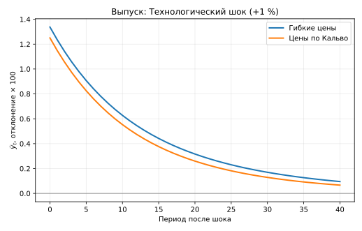
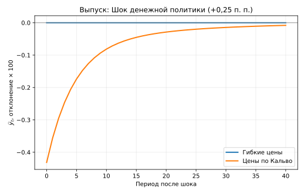
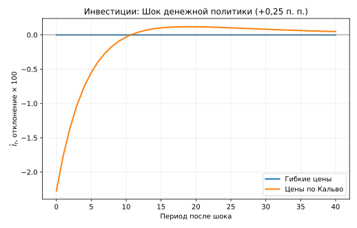
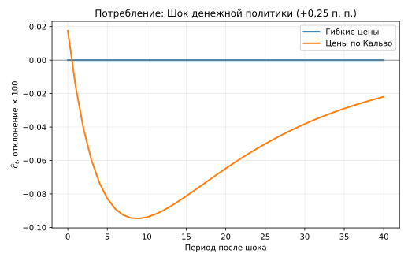

## Аннотация

В работе исследуется, как ограничения на пересмотр цен меняют реакции экономики на технологические и денежно-кредитные возмущения при эндогенном накоплении физического капитала. Сопоставляются два режима одной и той же экономики: гибкие цены и случайные возможности пересмотра цен по Кальво. Домохозяйство выбирает потребление, труд, инвестиции, номинальные облигации и реальные денежные остатки; последние непосредственно входят в функцию полезности. Монополистическая конкуренция, технология, предпочтения и правило центрального банка одинаковы в обоих режимах. Мы аналитически определяем стационарное состояние, выводим систему первого порядка и проверяем её независимыми численными производными и упорядоченным разложением Шура. При выбранной иллюстративной калибровке оба линейных равновесия локально определены. В ответ на положительную инновацию денежного правила выпуск при гибких ценах не меняется, а при ценах по Кальво первоначально сокращается приблизительно на 0,431 %, инвестиции — на 2,275 %. Работа представляет воспроизводимый теоретико-численный эксперимент, а не оценку параметров по наблюдаемым данным; выводы не распространяются автоматически на нелинейное равновесие и благосостояние.

**Ключевые слова:** динамическое общее равновесие; цены по Кальво; накопление капитала; деньги в полезности; рациональные ожидания; импульсные отклики; определённость равновесия.

## 1. Введение

Центральный вопрос исследования состоит в следующем: **как номинальная негибкость цен меняет равновесные реакции выпуска, потребления, инвестиций, труда и инфляции на одни и те же технологические и денежно-кредитные шоки, если физический капитал накапливается эндогенно?** Чтобы ответ не смешивал динамическую негибкость с рыночной властью, оба режима сохраняют одинаковую монополистическую конкуренцию и одну и ту же стационарную надбавку к предельным издержкам. Режим гибких цен не отождествляется с совершенно конкурентной моделью реальных деловых циклов.

Базовые составляющие модели восходят к денежной модели домохозяйства с полезностью ликвидности, модели случайного пересмотра цен Кальво (1983) и анализу линейных равновесий с рациональными ожиданиями Бланшара — Кана (1980). Здесь не заявляется новый механизм ценообразования или эмпирическая идентификация. Цель — представить полностью воспроизводимый численный пример с проверкой соответствия между нелинейными условиями, их линеаризацией и полученным решением. Особое внимание уделено различию между номинальной безрисковой доходностью и случайной реальной доходностью облигации.

Вклад данной версии ограничен двумя результатами. Во-первых, получен численно согласованный общий стационар при одинаковой надбавке в обоих режимах. Во-вторых, найденные решения и импульсные отклики проверены альтернативным методом упорядоченного разложения Шура и независимым вычислением производных. Эти проверки относятся к модели первого порядка около детерминированного стационара с нулевой инфляцией.

## 2. Экономическая среда и задача домохозяйства

Экономика закрыта. Время дискретно; период обозначен индексом \(t=0,1,\ldots\). Представительное домохозяйство выбирает потребление \(C_t\), предложение труда \(N_t\), капитал \(K_{t+1}\), номинальные облигации \(B_t\) и номинальные остатки \(M_t\). Предпочтения имеют вид

$$
E_0\sum_{t=0}^{\infty}\beta^t
\left[
\frac{C_t^{1-\sigma}-1}{1-\sigma}
-\chi_n\frac{N_t^{1+\varphi}}{1+\varphi}
+\chi_m\frac{(M_t/P_t)^{1-\eta_m}-1}{1-\eta_m}
\right].
$$

Для показателей, равных единице, соответствующий член понимается как логарифмический предел. Здесь \(0<\beta<1\); остальные параметры предпочтений положительны. Реальные остатки \(m_t=M_t/P_t\) дают текущие услуги ликвидности, а потребление и деньги аддитивно сепарабельны.

В периоде \(t\) домохозяйство покупает номинальную облигацию за \(B_t\) денежных единиц, которая принесёт \((1+i_t)B_t\) денежных единиц в следующем периоде. Его номинальное бюджетное ограничение имеет вид

$$
\begin{aligned}
P_t C_t+P_tK_{t+1}+B_t+M_t
={}&W_tN_t+P_t(r_t^k+1-\delta)K_t\\
&+(1+i_{t-1})B_{t-1}+M_{t-1}+D_t+P_tT_t.
\end{aligned}
$$

Здесь \(r_t^k\) — реальная арендная плата за единицу установленного капитала, \(\delta\) — норма амортизации, \(D_t\) — номинальные дивиденды, \(T_t\) — чистые трансферты в единицах конечного товара. Капитал \(K_t\) предопределён в начале периода, тогда как \(K_{t+1}\) выбирается в периоде \(t\).

Определим валовую инфляцию \(\Pi_t=P_t/P_{t-1}\) и стохастический дисконтирующий фактор реального потребления

$$
\mathcal M_{t,t+1}
=\beta\left(\frac{C_{t+1}}{C_t}\right)^{-\sigma}.
$$

При внутренних решениях условия оптимальности для капитала и номинальной облигации записываются как

$$
1=E_t\!\left[
\mathcal M_{t,t+1}(r_{t+1}^k+1-\delta)
\right],
\qquad
1=E_t\!\left[
\mathcal M_{t,t+1}\frac{1+i_t}{\Pi_{t+1}}
\right].
$$

Облигация безрискова **номинально**, но при случайной инфляции её реальная доходность \((1+i_t)/\Pi_{t+1}\) не известна в момент \(t\). Для труда и денег получаем

$$
\chi_n N_t^\varphi=C_t^{-\sigma}w_t,
\qquad
\frac{\chi_m m_t^{-\eta_m}}{C_t^{-\sigma}}
=\frac{i_t}{1+i_t}.
$$

Условие денежного спроса показывает альтернативную стоимость хранения денег, не выплачивающих номинального процента. Аддитивная сепарабельность означает, что при процентном правиле и эндогенном предложении денег остатки \(m_t\) восстанавливаются после решения реального и инфляционного блоков. Допустимость бесконечного плана требует ограничений заимствования, исключающих схемы Понци, и соответствующих трансверсальных условий; локальные численные тесты ниже сами по себе их не доказывают.

## 3. Фирмы, рыночная структура и установление цен

Совершенно конкурентная фирма конечного продукта агрегирует дифференцированные товары по технологии Диксита — Стиглица:

$$
Y_t=\left(\int_0^1Y_t(j)^{(\varepsilon-1)/\varepsilon}dj
\right)^{\varepsilon/(\varepsilon-1)},\qquad
Y_t(j)=\left(\frac{P_t(j)}{P_t}\right)^{-\varepsilon}Y_t,
$$

где \(\varepsilon>1\). Промежуточная фирма использует капитал и труд:

$$
Y_t(j)=A_t K_t(j)^\alpha N_t(j)^{1-\alpha},
\qquad 0<\alpha<1.
$$

Капитал и труд свободно перераспределяются между фирмами внутри периода, поэтому цены факторов и реальные предельные издержки \(mc_t\) общие. С учётом ценовой дисперсии

$$
\Delta_t=\int_0^1
\left(\frac{P_t(j)}{P_t}\right)^{-\varepsilon}dj
$$

агрегированное производство и условия спроса на факторы удовлетворяют

$$
Y_t=\frac{A_t K_t^\alpha N_t^{1-\alpha}}{\Delta_t},
\quad
w_t=(1-\alpha)mc_t\frac{Y_t\Delta_t}{N_t},
\quad
r_t^k=\alpha mc_t\frac{Y_t\Delta_t}{K_t}.
$$

### 3.1. Гибкие цены

При возможности пересматривать цены в каждом периоде фирма устанавливает постоянную оптимальную надбавку \(\mu=\varepsilon/(\varepsilon-1)\). Поэтому в симметричном равновесии

$$
mc_t=\mu^{-1}=\frac{\varepsilon-1}{\varepsilon},
\qquad \Delta_t=1.
$$

Монополистическая конкуренция и связанные с ней стационарные искажения сохраняются и в этом контрольном режиме.

### 3.2. Цены по Кальво

С вероятностью \(1-\theta\) фирма может выбрать новую цену, а с вероятностью \(\theta\) обязана сохранить прежнюю. Обозначим относительную цену пересмотра \(p_t^*=P_t^*/P_t\), а предельную полезность потребления \(\lambda_t=C_t^{-\sigma}\). Оптимальная цена определяется рекурсивной системой

$$
\begin{aligned}
F_t&=\lambda_tmc_tY_t+
\beta\theta E_t[\Pi_{t+1}^{\varepsilon}F_{t+1}],\\
G_t&=\lambda_tY_t+
\beta\theta E_t[\Pi_{t+1}^{\varepsilon-1}G_{t+1}],\\
p_t^*&=\frac{\varepsilon}{\varepsilon-1}\frac{F_t}{G_t}.
\end{aligned}
$$

Здесь множитель \(\beta\) уже содержится в рекурсии и не должен учитываться второй раз. Индекс цен и ценовая дисперсия подчиняются

$$
1=(1-\theta)(p_t^*)^{1-\varepsilon}
+\theta\Pi_t^{\varepsilon-1},
$$

$$
\Delta_t=(1-\theta)(p_t^*)^{-\varepsilon}
+\theta\Pi_t^\varepsilon\Delta_{t-1}.
$$

Нулевой тренд инфляции и общий рынок факторов позволяют получить в первом порядке стандартную новокейнсианскую кривую Филлипса:

$$
\pi_t=\beta E_t\pi_{t+1}+\kappa_p\widehat{mc}_t,\qquad
\kappa_p=\frac{(1-\theta)(1-\beta\theta)}{\theta}.
$$

Здесь \(\pi_t=\log\Pi_t\), а \(\widehat{mc}_t\) — логарифмическое отклонение реальных предельных издержек от стационара. Для первого порядка вокруг нулевой инфляции \(\widehat{\Delta}_t=0\) при стационарной начальной дисперсии. Это не означает отсутствия издержек ценовой дисперсии во втором порядке.

## 4. Общее равновесие и денежная политика

Товары используются на потребление и валовые инвестиции:

$$
Y_t=C_t+I_t,\qquad
K_{t+1}=(1-\delta)K_t+I_t.
$$

Рынки труда и капитала очищаются в обоих режимах цен. Номинальные облигации имеют нулевое чистое предложение, то есть в агрегате \(B_t=0\); прибыль фирм возвращается домохозяйствам как дивиденды. Для согласованного бюджета консолидированных денежных властей без государственных закупок и долга реальные чистые трансферты могут финансироваться эмиссией: \(P_tT_t=M_t-M_{t-1}\). При процентном правиле количество денег эндогенно приспосабливается к денежному спросу.

Стационарная валовая номинальная ставка равна \(1+\bar i=1/\beta\). Правило политики в локальных координатах:

$$
\widetilde i_t=\phi_\pi\pi_t+\phi_y\widehat y_t+v_t,
\qquad
\widetilde i_t=\log(1+i_t)-\log(1+\bar i).
$$

**Важно:** реакция центрального банка определяется отклонением выпуска \(\widehat y_t\) от его стационарного значения, а не разрывом относительно гибкоценового выпуска. При сопоставлении двух режимов это правило не изменяется. Экзогенные процессы имеют вид

$$
\widehat a_{t+1}=\rho_a\widehat a_t+\epsilon^a_{t+1},
\qquad
v_{t+1}=\rho_v v_t+\epsilon^v_{t+1}.
$$

Инновации не коррелируют с доступной на момент \(t\) информацией. Денежный шок \(v_t\) является **инновацией правила**, а не обязательно фактическим увеличением равновесной номинальной ставки на ту же величину.

## 5. Аналитическое стационарное состояние

Положим \(A=1\), \(\Pi=1\) и \(\Delta=1\). Условия Эйлера дают

$$
\bar r^k=\beta^{-1}-1+\delta,
\qquad
\bar i=\beta^{-1}-1,
\qquad
\overline{mc}=\frac{\varepsilon-1}{\varepsilon}.
$$

Стационарные доли выводятся без численного поиска:

$$
\frac{\bar K}{\bar Y}=
\frac{\alpha\overline{mc}}{\bar r^k},
\quad
s_I=\frac{\bar I}{\bar Y}=
\delta\frac{\bar K}{\bar Y},
\quad
s_C=1-s_I.
$$

Для трудо-капитального отношения

$$
\frac{\bar K}{\bar N}
=\left(\frac{\alpha\overline{mc}}{\bar r^k}\right)^{1/(1-\alpha)},
\qquad
\frac{\bar Y}{\bar N}
=\left(\frac{\bar K}{\bar N}\right)^\alpha.
$$

Заработная плата равна
\(\bar w=(1-\alpha)\overline{mc}\,(\bar Y/\bar N)\). Пусть \(\bar C/\bar N=s_C(\bar Y/\bar N)\). Тогда

$$
\bar N=
\left[
\frac{\bar w}{\chi_n}
\left(s_C\frac{\bar Y}{\bar N}\right)^{-\sigma}
\right]^{1/(\varphi+\sigma)},
\qquad
\bar m=
\left[
\chi_m\bar C^\sigma
\frac{1+\bar i}{\bar i}
\right]^{1/\eta_m}.
$$

Указанные условия требуют \(0<s_I<1\). Одинаковая стационарная надбавка обеспечивает совпадение стационарных реальных значений двух режимов. При базовой калибровке получены следующие значения:

| Показатель | Значение |
|:--|--:|
| Реальная аренда капитала \(\bar r^k\) | 0,035101 |
| Номинальная чистая ставка \(\bar i\) | 0,010101 |
| Реальные предельные издержки | 0,833333 |
| Капитал к выпуску | 7,834532 |
| Инвестиции к выпуску | 0,195863 |
| Потребление к выпуску | 0,804137 |
| Труд \(\bar N\) | 0,833263 |
| Выпуск \(\bar Y\) | 2,296765 |
| Потребление \(\bar C\) | 1,846913 |
| Капитал \(\bar K\) | 17,994083 |

## 6. Линеаризация и динамическая система

Для положительных переменных \(\widehat x_t=\log(X_t/\bar X)\). Процентная ставка применяется только в определении \(\widetilde i_t\), приведённом выше. Первые производные агрегированного производства, спроса на факторы и предложения труда дают

$$
\widehat y_t=\widehat a_t+\alpha\widehat k_t
+(1-\alpha)\widehat n_t,
$$

$$
\widehat{mc}_t=\sigma\widehat c_t
+(\varphi+\alpha)\widehat n_t
-\widehat a_t-\alpha\widehat k_t,
$$

$$
\widehat r_t^k=\sigma\widehat c_t
+(1+\varphi)\widehat n_t-\widehat k_t.
$$

Уравнения накопления капитала, облигационного и капитального выбора соответственно приводят к

$$
\widehat k_{t+1}=(1-\delta)\widehat k_t+
\frac{\delta}{s_I}(\widehat y_t-s_C\widehat c_t),
$$

$$
E_t\widehat c_{t+1}
=\widehat c_t+\frac{\widetilde i_t-E_t\pi_{t+1}}{\sigma},
$$

$$
\sigma(E_t\widehat c_{t+1}-\widehat c_t)
=q E_t\widehat r_{t+1}^k,\qquad
q=\beta\bar r^k.
$$

Спрос на деньги восстанавливается статически:

$$
\eta_m\widehat m_t
=\sigma\widehat c_t-\frac{1}{\bar i}\widetilde i_t.
$$

Для цен по Кальво динамический вектор после исключения статических переменных состоит из состояний \((\widehat k_t,\widehat a_t,v_t)\) и переменных скачка \((\widehat c_t,\pi_t,\widehat n_t)\). Хотя труд выбирается внутрипериодно, его ожидание на следующий период в редуцированной системе определяется капитальным уравнением Эйлера. При гибких ценах из \(\widehat{mc}_t=0\) можно исключить труд, и остаются две переменные скачка — потребление и инфляция.

Динамическую систему записываем как

$$
\begin{pmatrix}x_{t+1}\\E_ty_{t+1}\end{pmatrix}
=\mathsf A
\begin{pmatrix}x_t\\y_t\end{pmatrix}
+\begin{pmatrix}\mathsf G\\0\end{pmatrix}\epsilon_{t+1}.
$$

Для расчёта политики \(y_t=\mathsf P x_t\) необходимо не только совпадение числа собственных значений вне единичного круга с числом переменных скачка, но и условие полного ранга соответствующего инвариантного подпространства.

## 7. Калибровка и метод численного решения

Ни один из параметров ниже не оценивался на наблюдаемых данных. Они выбраны для воспроизводимого иллюстративного эксперимента.

| Параметр | Значение | Интерпретация |
|:--|--:|:--|
| \(\beta\) | 0,99 | Дисконтирование |
| \(\alpha\) | 0,33 | Доля капитала в технологии |
| \(\delta\) | 0,025 | Амортизация за период |
| \(\varepsilon\) | 6 | Эластичность замещения |
| \(\theta\) | 0 или 0,75 | Вероятность сохранения цены |
| \(\sigma,\varphi\) | 1; 1 | Кривизна потребления и труда |
| \(\chi_n,\chi_m,\eta_m\) | 1; 1; 1 | Труд и ликвидность |
| \(\phi_\pi,\phi_y\) | 1,5; 0,125 | Реакция денежной политики |
| \(\rho_a,\rho_v\) | 0,9; 0,8 | Устойчивость шоков |

После аналитического вычисления стационара независимая численная дифференциация исходных нелинейных условий даёт коэффициенты линеаризованной системы. Затем найденное исходное решение на собственных векторах сравнивается с решением, построенным методом упорядоченного обобщённого разложения Шура (QZ). Отдельно проверяются число нестабильных корней, ранг, инвариантность подпространства и остатки уравнений. Таким образом, совпадение нескольких численных путей является тестом корректности **линейного решения**, а не доказательством глобальной определённости.

## 8. Численная определённость и независимая проверка

В обоих режимах максимальный абсолютный остаток проверенных нелинейных условий в стационаре составляет \(1{,}11\times10^{-16}\). Сравнение матриц, полученных аналитической реализацией и независимыми центральными разностями, даёт следующие результаты:

| Диагностика | Гибкие цены | Цены по Кальво |
|:--|--:|--:|
| Максимальное расхождение матриц | \(5{,}00\times10^{-11}\) | \(9{,}14\times10^{-10}\) |
| Нестабильные корни | 2 | 3 |
| Независимые переменные скачка | 2 | 3 |
| Минимальное сингулярное число блока ранга | 0,5664 | 0,3264 |
| Согласованность QZ и метода собственных векторов | Да | Да |

Для гибких цен собственные значения составляют \(0{,}800000\), \(0{,}900000\), \(0{,}951375\), \(1{,}072633\), \(1{,}500000\). Для цен по Кальво значения равны \(0{,}800000\), \(0{,}900000\), \(0{,}945482\), \(1{,}068381\), \(1{,}663903\), \(2{,}243578\). Таким образом, три состояния соответствуют трём корням внутри единичного круга, а число нестабильных корней совпадает с числом переменных скачка в каждом режиме. Условия ранга также выполняются.

Наклон кривой Филлипса при \(\theta=0{,}75\) равен \(\kappa_p=0{,}0858333\). Независимая дифференциация точных рекурсий пересмотра цен подтверждает этот коэффициент для выбранных предпосылок. Программа автоматической проверки завершает 19 тестов без ошибок. Максимальное различие рассчитанных двумя методами импульсных откликов за 41 период ниже \(7\times10^{-11}\) логарифмической единицы.

## 9. Импульсные отклики

Положительная технологическая инновация задаётся как \(\epsilon^a_0=0{,}01\) логарифмической единицы (примерно 1 %). Положительная инновация денежного правила задаётся как \(\epsilon^v_0=0{,}0025\) логарифмической единицы валовой номинальной ставки. Траектории рассчитываются на горизонте от нулевого до сорокового периода. Все показатели в таблице ниже — первоначальные отклонения, умноженные на 100, то есть приблизительные процентные изменения или процентные пункты для инфляции.

| Переменная, период 0 | Технология: гибкие | Технология: Кальво | Денежный шок: гибкие | Денежный шок: Кальво |
|:--|--:|--:|--:|--:|
| Выпуск | +1,337 | +1,250 | 0,000 | −0,431 |
| Потребление | +0,331 | +0,349 | 0,000 | +0,018 |
| Инвестиции | +5,470 | +4,948 | 0,000 | −2,275 |
| Труд | +0,503 | +0,373 | 0,000 | −0,644 |
| Инфляция | −0,238 | −0,229 | −0,357 | −0,320 |

### 9.1. Технологическое возмущение

При гибких ценах первоначальный рост выпуска составляет приблизительно 1,337 %, а при Кальво — 1,250 %. Рост инвестиций достигает соответственно 5,470 % и 4,948 %. В обоих режимах распространение технологического шока происходит через доходность установленного капитала и оптимальные планы накопления; ценовая негибкость меняет количественную реакцию и динамику инфляции.

{#fig-technology-output width=88%}

### 9.2. Денежно-кредитное возмущение

При гибких ценах и аддитивно-сепарабельной полезности денег положительная инновация денежного правила не меняет реальные решения. При Кальво первоначальные выпуск и труд сокращаются на 0,431 % и 0,644 %, а инвестиции — на 2,275 %. Таким образом, основная часть первоначального изменения реальных расходов при выбранной калибровке приходится на инвестиции.

{#fig-monetary-output width=88%}

{#fig-monetary-investment width=88%}

Первоначальное потребление при Кальво **немного увеличивается** (примерно на 0,018 %). Этот знак нельзя скрывать или заменять стандартной интуицией простой трёхуравневой модели: в данной постановке инвестиции могут меняться без издержек корректировки, а ресурсное ограничение требует согласованного распределения выпуска между потреблением и накоплением капитала. Это результат конкретной калибровки, а не общий закон денежной трансмиссии.

{#fig-monetary-consumption width=88%}

Положительный шок \(v_t\) не тождествен увеличению **реализованной** номинальной ставки на ту же величину: эндогенное изменение выпуска и инфляции входит в правило центрального банка. Интерпретация знаков требует учитывать все члены этого правила.

## 10. Границы результатов и интерпретация

Полученная разница между режимами характеризует локальную динамику конкретной экономики при заданной калибровке, а не причинный эффект, оценённый на реальных данных. В частности, в данной версии отсутствуют издержки корректировки инвестиций, фирменно-специфический капитал и политика, ориентированная непосредственно на гибкоценовой разрыв выпуска. Предполагается, что факторы производства свободно перемещаются между фирмами, поэтому стандартный коэффициент наклона Кальво неприменим к моделям с фирменно-специфическими капитальными запасами без дополнительного вывода.

Во втором порядке ценовая дисперсия создаёт потери ресурсов, а стохастические ковариации доходностей становятся существенными для риск-премий и благосостояния. В настоящем расчёте они **не** оцениваются. Ограничения заимствования и трансверсальные условия не были независимо доказаны для полной бесконечномерной стохастической задачи. Следовательно, результаты не следует называть решением полной нелинейной экономики.

Наконец, численная определённость подтверждена для **одного** набора параметров. Условие вида \(\phi_\pi>1\), хотя и выполнено здесь, само по себе не доказывает единственность для произвольной модели с капиталом. Статус результатов ограничивается проверенными собственными значениями и рангом соответствующего численного оператора.

## 11. Заключение

Сравнение двух режимов ценообразования в экономике с капиталом, номинальными облигациями и полезностью денег показывает, что номинальная негибкость меняет передачу денежного шока в реальные переменные. При фиксированных предпочтениях, технологии, наценке и правиле политики гибкие цены обеспечивают нейтральность денежной инновации для реальных величин; при Кальво та же инновация приводит к первоначальному сокращению выпуска и особенно инвестиций. Независимые проверки производных, решений на инвариантном подпространстве и условий Бланшара — Кана подтверждают внутреннюю согласованность вычислительного эксперимента первого порядка.

Этот вывод следует интерпретировать как **воспроизводимый эталонный численный результат**, пригодный для дальнейшего расширения, но не как новую эмпирическую оценку или результат анализа благосостояния. Следующая исследовательская задача — отдельно исследовать устойчивость эффекта к изменению калибровки и к издержкам корректировки капитала; такие упражнения не включены в приведённые оценки.

## Приложение. Протокол воспроизводимости

Исходные уравнения, код решения и проверки сохранены вместе с настоящим текстом. Для пересчёта используются Python, NumPy, SciPy и Matplotlib. Проверки запускаются последовательно:

    python -m pip install -r requirements.txt
    python -m unittest discover -s tests -v
    python -m src.audit
    python -m src.experiment

Четыре таблицы импульсных откликов содержатся в каталоге results; диагностические таблицы стационара, Якобианов и собственных корней — там же. Отдельные векторные изображения находятся в каталоге figures. Исходный текст статьи хранится в файле paper.qmd и преобразуется в PDF командой:

    quarto render paper.qmd --to typst

Публикуемый PDF генерируется из этого файла внутри GitHub Actions. Внешний численный ввод в ходе сборки документа не выполняется: графики и таблицы основаны на проверенных результатах модели. Полный путь вычислений и исходные значения параметров включены в репозиторий.

## Литература

1. Кальво, Г. А. (1983). «Staggered Prices in a Utility-Maximizing Framework». *Journal of Monetary Economics*, 12(3), 383–398. DOI: 10.1016/0304-3932(83)90060-0.
2. Бланшар, О. Ж., Кан, Ч. М. (1980). «The Solution of Linear Difference Models under Rational Expectations». *Econometrica*, 48(5), 1305–1311. DOI: 10.2307/1912186.
3. Симс, К. А. (2002). «Solving Linear Rational Expectations Models». *Computational Economics*, 20(1–2), 1–20.
4. Гали, Ж. (2015). *Monetary Policy, Inflation, and the Business Cycle: An Introduction to the New Keynesian Framework*. Второе издание. Princeton University Press.
5. Вудфорд, М. (2003). *Interest and Prices: Foundations of a Theory of Monetary Policy*. Princeton University Press.
