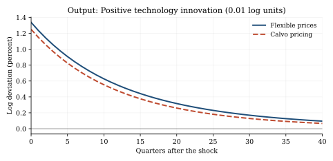
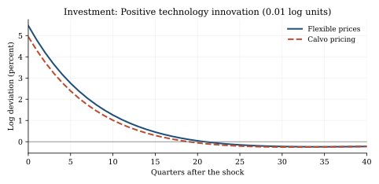
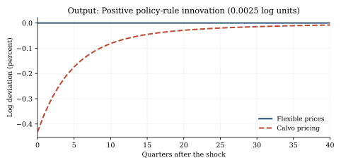
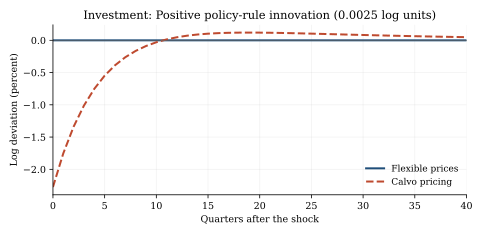
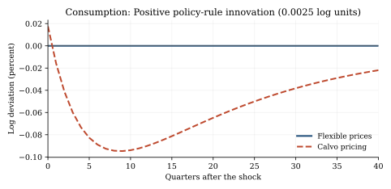
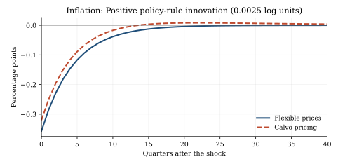

# Introduction

In the standard three-equation New Keynesian model, output, inflation, and the nominal interest rate summarize monetary transmission. Investment is absent as a separate choice, however, and the goods-market identity is often $Y_t=C_t$. Incorporating capital accumulation makes it possible to trace the responses of consumption and investment separately. It also disciplines the relationship between current factor prices and expected returns on physical capital. These ingredients matter for interpreting a monetary-policy innovation, even in an otherwise conventional representative-household economy.

Our question is narrowly defined: **How does restricting the frequency of price adjustment change the response of the same economy to the same exogenous shock?** A comparison of perfect competition under flexible prices with monopolistic competition under sticky prices would confound nominal rigidity with a difference in product-market power. Instead, both regimes in this paper share the same monopolistic markup, technology, household preferences, and policy rule. The probability of retaining a previously chosen price is the only structural parameter that changes between the regimes.

We construct a model with capital, one-period nominal bonds, and money in the utility function (MIU). The latter follows the monetary-utility tradition of @sidrauski1967; staggered price setting follows @calvo1983. We solve the first-order approximation around a zero-inflation stationary equilibrium, compare impulse response functions (IRFs) to technology and policy-rule shocks, and validate the linear rational-expectations solution using numerical derivatives and an independently implemented ordered Schur procedure. Our comparison complements the standard New Keynesian monetary-transmission framework presented by @woodford2003 and @gali2015; it does not claim to introduce a new theoretical mechanism.

The benchmark results are sharp. A positive policy-rule innovation is neutral for real allocations in the flexible-price economy but leads to an initial output decline of 0.431 percent and investment decline of 2.275 percent in the Calvo economy. The same technology innovation initially raises output by 1.337 percent with flexible prices and 1.250 percent with staggered prices. These are **model-generated responses under one illustrative calibration**, not empirical estimates or robust sign restrictions across alternative parameterizations.

# Economic environment

## Household, assets, and timing

Time is discrete. The representative household chooses consumption $C_t$, hours $N_t$, capital $K_{t+1}$, a position $B_t$ in nominal one-period bonds, and nominal money balances $M_t$. Preferences are

$$
E_0 \sum_{t=0}^{\infty}\beta^t\left[
\frac{C_t^{1-\sigma}-1}{1-\sigma}
-\chi_n\frac{N_t^{1+\varphi}}{1+\varphi}
+\chi_m\frac{m_t^{1-\eta_m}-1}{1-\eta_m}
\right],\qquad m_t\equiv\frac{M_t}{P_t}.
$$

The consumption and monetary terms are interpreted by continuity at unit curvature. Capital $K_t$ is installed at the beginning of $t$; the real rental rate is $r_t^k$ and depreciation is $\delta$. Bonds purchased at the end of $t$ at unit nominal price pay $1+i_t$ units of money at $t+1$. Their nominal yield is therefore known at purchase, whereas their real yield is uncertain if next period's inflation is uncertain. The nominal budget constraint is

$$
\begin{aligned}
P_t C_t+P_t K_{t+1}+B_t+M_t
={}&W_tN_t+P_t(r_t^k+1-\delta)K_t\\
&+(1+i_{t-1})B_{t-1}+M_{t-1}+D_t+P_tT_t,
\end{aligned}
$$

where $D_t$ denotes nominal dividends and $T_t$ real net transfers. With interior choices, $\Pi_t=P_t/P_{t-1}$, and

$$
\mathcal M_{t,t+1}\equiv
\beta\left(\frac{C_{t+1}}{C_t}\right)^{-\sigma},
$$

the optimality conditions are

$$
\begin{aligned}
1&=E_t\left[\mathcal M_{t,t+1}(r_{t+1}^k+1-\delta)\right],\\
1&=E_t\left[\mathcal M_{t,t+1}\frac{1+i_t}{\Pi_{t+1}}\right],\\
\chi_nN_t^\varphi&=C_t^{-\sigma} w_t,\\
\chi_m m_t^{-\eta_m}&=C_t^{-\sigma}\frac{i_t}{1+i_t},
\qquad w_t\equiv W_t/P_t.
\end{aligned}
$$

The second equation prices the inflation-risk exposure of nominal bonds. The fourth equates marginal liquidity services to the nominal opportunity cost of holding money. A non-Ponzi restriction and suitable transversality conditions complete the household problem; these global conditions are not established by the local linear solution. Because the MIU term is additively separable, real money balances are determined *recursively after* the consumption and nominal-rate allocation in this specification.

## Production, factor markets, and aggregation

Final output is a CES composite of differentiated goods, with elasticity of substitution $\varepsilon>1$:

$$
Y_t=\left(\int_0^1Y_t(j)^{(\varepsilon-1)/\varepsilon}\,dj\right)^{\varepsilon/(\varepsilon-1)},
\qquad
Y_t(j)=\left(\frac{P_t(j)}{P_t}\right)^{-\varepsilon}Y_t.
$$

Intermediate producer $j$ uses $Y_t(j)=A_tK_t(j)^{\alpha}\,N_t(j)^{1-\alpha}$. Labor and installed capital services can be reallocated across firms each period. Competitive factor markets imply common real marginal cost $mc_t$ and

$$
\begin{aligned}
w_t&=mc_t(1-\alpha)\frac{Y_t\Delta_t}{N_t},\\
r_t^k&=mc_t\alpha\frac{Y_t\Delta_t}{K_t},\\
Y_t&=\frac{A_tK_t^\alpha N_t^{1-\alpha}}{\Delta_t},
\qquad
\Delta_t\equiv\int_0^1\left(\frac{P_t(j)}{P_t}\right)^{-\varepsilon}dj.
\end{aligned}
$$

There are no capital adjustment costs and no government purchases. The aggregate resource and capital laws are

$$
Y_t=C_t+I_t,\qquad K_{t+1}=(1-\delta)K_t+I_t.
$$

The representative household receives intermediate-firm profits, $D_t/P_t=Y_t-w_tN_t-r_t^kK_t$. Government bonds have zero net supply, $B_t=0$ in equilibrium. The monetary authority supplies money elastically to accommodate its nominal interest-rate rule, and the consolidated public budget requires $P_tT_t=M_t-M_{t-1}$ in this no-public-debt, no-government-spending environment. The paper solves the local real allocation and associated monetary variables; it does not compute a separate exact stochastic path for all nominal public liabilities.

## Flexible prices and Calvo price adjustment

With flexible prices, each monopolistically competitive intermediate producer charges the constant desired markup $\mu=\varepsilon/(\varepsilon-1)$. Hence

$$
mc_t=\mu^{-1}=\frac{\varepsilon-1}{\varepsilon},\qquad \Delta_t=1.
$$

**Flexible prices do not imply perfect competition here.** With Calvo pricing, a firm resets its price with probability $1-\theta$ and otherwise retains its previous nominal price. Write $p_t^*=P_t^*/P_t$ for the reset price relative to the final-good price and $\lambda_t=C_t^{-\sigma}$. Under common marginal costs, exact reset-price recursions are

$$
\begin{aligned}
F_t&=\lambda_tmc_tY_t+\beta\theta E_t\left[\Pi_{t+1}^{\varepsilon}F_{t+1}\right],\\
G_t&=\lambda_tY_t+\beta\theta E_t\left[\Pi_{t+1}^{\varepsilon-1}G_{t+1}\right],\\
p_t^*&=\frac{\varepsilon}{\varepsilon-1}\frac{F_t}{G_t}.
\end{aligned}
$$

The $F_t,G_t$ terms contain marginal utility and therefore do not require another stochastic discount factor on top of the displayed $\beta$. Aggregation gives

$$
\begin{aligned}
1&=(1-\theta)(p_t^*)^{1-\varepsilon}+\theta\Pi_t^{\varepsilon-1},\\
\Delta_t&=(1-\theta)(p_t^*)^{-\varepsilon}+\theta\Pi_t^\varepsilon\Delta_{t-1}.
\end{aligned}
$$

At a zero-inflation steady state, the first-order Calvo pricing condition is

$$
\pi_t=\beta E_t\pi_{t+1}+\kappa_p\widehat{mc}_t,
\qquad
\kappa_p=\frac{(1-\theta)(1-\beta\theta)}{\theta}.
$$

Here $\pi_t=\log\Pi_t$ and $\widehat{mc}_t$ is the log deviation of marginal cost from its stationary value. The slope assumes a *common* marginal cost, not firm-specific capital. Price dispersion vanishes from aggregate production at first order around zero inflation and $\Delta=1$, but not at second order.

## Monetary policy and disturbances

The central bank follows

$$
1+i_t=(1+\bar i)\left(\frac{\Pi_t}{\bar\Pi}\right)^{\phi_\pi}
\left(\frac{Y_t}{\bar Y}\right)^{\phi_y}\exp(v_t),
\qquad \bar\Pi=1.
$$

The rule responds to the deviation of **output from steady state**, not to the gap from flexible-price natural output. Technology and policy-rule shocks evolve according to

$$
\log A_{t+1}=\rho_a\log A_t+\varepsilon^a_{t+1},\qquad
v_{t+1}=\rho_v v_t+\varepsilon^v_{t+1}.
$$

The shocks are treated as independent. A positive innovation $v_t$ shifts the *rule* upward conditional on endogenous inflation and output; it need not raise the realized equilibrium nominal rate on impact.

# Steady state and first-order equilibrium

## Analytical stationary allocation

Let $A=1$, $\Pi=1$, and $\Delta=1$. Both pricing regimes share $mc=(\varepsilon-1)/\varepsilon$. The steady-state relations are

$$
\begin{aligned}
r^k&=\beta^{-1}-1+\delta, &\bar i&=\beta^{-1}-1,\\
\frac{K}{Y}&=\frac{\alpha mc}{r^k},&\frac{I}{Y}&=\delta\frac{K}{Y},\\
\frac{C}{Y}&=1-\frac{I}{Y},&
\frac{K}{N}&=\left(\frac{\alpha mc}{r^k}\right)^{1/(1-\alpha)}.
\end{aligned}
$$

From $Y/N=(K/N)^\alpha$, $w=mc(1-\alpha)Y/N$, and the labor first-order condition,

$$
N=\left[\frac{w}{\chi_n}
\left(\frac{C}{Y}\frac{Y}{N}\right)^{-\sigma}\right]^{1/(\varphi+\sigma)}.
$$

The remaining levels follow from $Y=(Y/N)N$, $C=(C/Y)Y$, $K=(K/N)N$, and $I=\delta K$. Money demand implies $m=[\chi_m C^\sigma(1+\bar i)/\bar i]^{1/\eta_m}$. The stationary real allocation is identical across the pricing regimes because their desired markup is identical.

## Illustrative calibration

Table @tbl-parameters reports the numerical inputs. These values are deliberately illustrative and have **not** been estimated from microeconomic or macroeconomic data.

| Parameter | Value | Parameter | Value |
|:---|---:|:---|---:|
| Discount factor $\beta$ | 0.99 | Capital share $\alpha$ | 0.33 |
| Depreciation $\delta$ | 0.025 | Demand elasticity $\varepsilon$ | 6 |
| Risk aversion $\sigma$ | 1 | Labor curvature $\varphi$ | 1 |
| Labor weight $\chi_n$ | 1 | Money weight $\chi_m$ | 1 |
| Money curvature $\eta_m$ | 1 | Inflation response $\phi_\pi$ | 1.5 |
| Output response $\phi_y$ | 0.125 | Technology persistence $\rho_a$ | 0.9 |
| Policy-shock persistence $\rho_v$ | 0.8 | Calvo non-reset probability $\theta$ | 0.75 |
| Flexible-price $\theta$ | 0 | Gross steady-state inflation $\bar\Pi$ | 1 |

: Parameter values for the benchmark experiment. {#tbl-parameters}

The stationary markup is 1.2; $K/Y=7.8345$, $I/Y=0.1959$, and $C/Y=0.8041$. The Calvo Phillips-curve coefficient is $\kappa_p=0.0858333$.

## Linear equilibrium and determinacy

Write $\hat x_t=\log(X_t/\bar X)$ for positive real quantities and $\widetilde i_t=\log(1+i_t)-\log(1+\bar i)$ for the gross nominal rate. With $s_C=C/Y$, $s_I=I/Y$, and $q=\beta r^k$, the first-order conditions imply

$$
\begin{aligned}
\hat y_t&=\hat a_t+\alpha\hat k_t+(1-\alpha)\hat n_t,\\
\widehat{mc}_t&=\sigma\hat c_t+(\varphi+\alpha)\hat n_t-\hat a_t-\alpha\hat k_t,\\
\hat r_t^k&=\sigma\hat c_t+(1+\varphi)\hat n_t-\hat k_t,\\
\hat k_{t+1}&=(1-\delta)\hat k_t+\frac{\delta}{s_I}(\hat y_t-s_C\hat c_t),\\
\hat c_t&=E_t\hat c_{t+1}-\frac{q}{\sigma}E_t\hat r_{t+1}^k,\\
\hat c_t&=E_t\hat c_{t+1}-\frac{\widetilde i_t-E_t\pi_{t+1}}{\sigma},\\
\widetilde i_t&=\phi_\pi\pi_t+\phi_y\hat y_t+v_t,\\
\eta_m\hat m_t&=\sigma\hat c_t-\frac{1}{\bar i}\widetilde i_t.
\end{aligned}
$$

For $\theta>0$ the Phillips curve is added; at $\theta=0$ it is **replaced** by $\widehat{mc}_t=0$ rather than evaluated at a singular slope. After eliminating redundant static variables, the Calvo system has states $(\hat k_t,\hat a_t,v_t)$ and jump variables $(\hat c_t,\pi_t,\hat n_t)$. Under flexible prices, the constant-marginal-cost condition eliminates hours and the jump vector is $(\hat c_t,\pi_t)$. The system can be written $E_tz_{t+1}=\mathsf A z_t$.

We check local determinacy using the Blanchard--Kahn root count and the rank of the relevant invariant-subspace projection [@blanchardkahn1980]. An independent ordered QZ decomposition of the *reduced nonsingular transition system* provides a numerical cross-check. This does not amount to an unrestricted solution of a singular generalized linear rational-expectations pencil.

# Numerical verification and impulse responses

## Independent numerical audit

The analytically derived stationary allocation is substituted into the original nonlinear equilibrium equations. The maximum absolute stationary residual is $1.11\times10^{-16}$. Independently computed central-difference derivatives agree with the transition matrix used by the simulation code to $5.00\times10^{-11}$ under flexible prices and $9.14\times10^{-10}$ under Calvo pricing. The linear Calvo price condition is separately recovered from the derivatives of the exact reset-price recursions.

| Verification statistic | Flexible prices | Calvo pricing |
|:---|---:|---:|
| Unstable eigenvalues | 2 | 3 |
| Independent jump variables | 2 | 3 |
| Minimum singular value of rank block | 0.5664 | 0.3264 |
| Maximum transition-matrix difference | $5.00\times10^{-11}$ | $9.14\times10^{-10}$ |
| Rank condition | Satisfied | Satisfied |

: Independent verification of the reduced equilibrium systems. {#tbl-validation}

The eigenvalues are $0.8000$, $0.9000$, $0.9514$, $1.0726$, and $1.5000$ for flexible prices, and $0.8000$, $0.9000$, $0.9455$, $1.0684$, $1.6639$, and $2.2436$ for Calvo prices. Each regime has a locally unique stable solution at the benchmark calibration. The two solution algorithms produce IRFs whose maximum difference across 41 quarters is below $7\times10^{-11}$ log units. All 19 existing audit and model tests passed in the documented benchmark environment. These diagnostics validate the *local first-order solution*, not a globally solved nonlinear stochastic equilibrium.

## Technology innovation

Technology rises unexpectedly by $0.01$ log units at date zero and then decays at rate $\rho_a=0.9$. Output rises by 1.337 percent under flexible prices and 1.250 percent under Calvo pricing in the impact quarter. Investment responds even more strongly: 5.470 percent and 4.948 percent, respectively. At this calibration, limited price adjustment modestly dampens the initial response to a favorable technology innovation.

{#fig-technology-output width=92%}

{#fig-technology-investment width=92%}

## Monetary policy-rule innovation

The monetary experiment introduces a positive policy-rule residual of $v_0=0.0025$ log units of the **gross nominal interest rate**. It is not a fixed increase in the equilibrium nominal interest rate: the feedback rule reacts simultaneously to inflation and output. Real output, investment, consumption, hours, and capital do not respond under flexible prices, consistent with monetary neutrality in this separable MIU model.

With Calvo pricing, output falls by $0.00431472$ log units (0.431 percent), investment falls by $0.02274988$ (2.275 percent), and hours fall by $0.00643988$ (0.644 percent) on impact. Consumption initially **rises** by $0.00017552$ log units (0.018 percent), rather than falling. This is a property of the particular frictionless investment technology and calibration; it is not imposed as a sign restriction. The realized nominal interest-rate deviation is negative at impact because endogenous inflation and output responses more than offset the positive innovation to the policy *rule*.

{#fig-monetary-output width=92%}

{#fig-monetary-investment width=92%}

{#fig-monetary-consumption width=92%}

{#fig-monetary-inflation width=92%}

Table @tbl-impact summarizes the initial responses in $100$ times log deviations. For quantities this is approximately a percentage change; for inflation and rates the relevant scaling corresponds to percentage points.

| Variable | Technology: flexible | Technology: Calvo | Policy: flexible | Policy: Calvo |
|:---|---:|---:|---:|---:|
| Output | 1.337 | 1.250 | 0.000 | -0.431 |
| Consumption | 0.331 | 0.349 | 0.000 | 0.018 |
| Investment | 5.470 | 4.948 | 0.000 | -2.275 |
| Hours worked | 0.503 | 0.373 | 0.000 | -0.644 |

: Impact-quarter responses, in log percent. Technology and monetary innovations are 0.01 and 0.0025 log units, respectively. {#tbl-impact}

The investment response accounts for much of the initial reduction in aggregate demand under nominal rigidity. The comparison isolates **price adjustment frequency**, because monopolistic power is present in both economies. It does not identify a monetary-policy shock in observational data and therefore does not yield an estimated causal policy effect.

# Interpretation and limitations

Three conclusions are supported. First, keeping the product-market markup fixed avoids a basic confound in sticky-versus-flexible comparisons. Second, capital accumulation makes the investment response visible and quantitatively substantial in the benchmark monetary experiment. Third, independent differentiation, Schur-based solution, rank diagnostics, and Euler-equation residual checks provide corroborating evidence for the local linear numerical solution.

The scope is important. Price dispersion is absent from the first-order resource constraint at the zero-inflation steady state but generates higher-order distortions; no welfare or second-order computation is performed. The full nonlinear stochastic fiscal and money-supply system has not been solved as a distinct model. There are no investment adjustment costs and no firm-specific capital, both of which may change transmission and inflation dynamics. Determinacy is verified for **one calibration** rather than proved over a parameter region. Finally, global household portfolio feasibility and transversality conditions do not follow from the BK check alone.

The main message is therefore conditional but clear: in a common-capital DSGE economy, introducing Calvo price-setting opportunities generates real responses to a monetary innovation that is neutral under flexible prices. In the specified benchmark, the impact effects are -0.431 percent for output and -2.275 percent for investment. These are reproducible theoretical results, not empirical estimates.

# Reproducibility

All equations, source code, baseline parameters, independent audit routines, and simulation outputs are available in the project repository, `Hirotaka-Fukui-Pitti-King/dsge-miu-calvo`. The solver in `src/model.py` constructs the steady state and the reduced linear system. `src/audit.py` independently validates its derivatives and Schur solution. `src/experiment.py` writes the four primary IRF data sets to `results/otkliki_*.csv`; `paper/scripts/make_figures.py` regenerates *English-language SVG figures* from those CSVs. `paper/scripts/check_results.py` tests the numerical values reported in the paper against the CSV output. The workflow runs the model tests, verifies the reported values, creates the English figures, and renders this `.qmd` source to a PDF with Quarto and Typst. On the main branch, it commits the compiled PDF into `paper/article.pdf` when the document changes. This pipeline is intended to keep the distributed manuscript tied to the verified model results.
