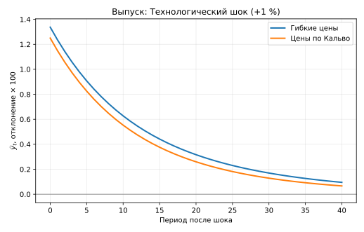
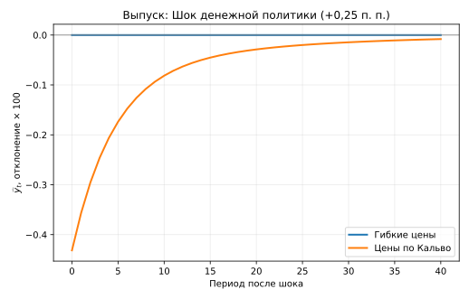
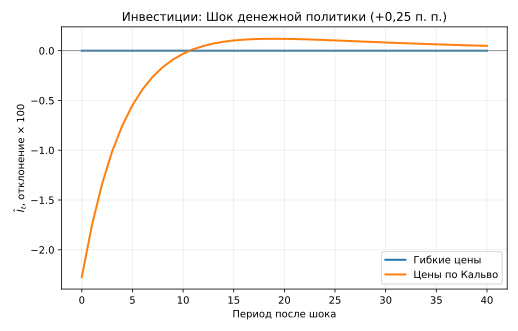
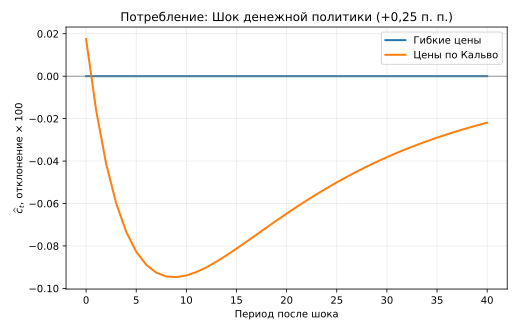

**Аннотация.** Исследуется, как ограничение частоты пересмотра цен изменяет отклики реальной экономики на технологические и денежно-кредитные инновации при наличии физического капитала. Мы сравниваем две версии одной модели общего равновесия: с гибкими ценами и с вероятностью сохранения цены по Кальво $\theta=0{,}75$. Предпочтения, производственная функция, монополистическая конкуренция, правило процентной ставки и параметры шоков совпадают; меняется только механизм ценообразования. При положительной инновации правила денежной политики на $0{,}0025$ логарифмической единицы валовой номинальной ставки в модели с негибкими ценами выпуск в первом периоде сокращается на $0{,}431\%$, инвестиции — на $2{,}275\%$, а труд — на $0{,}644\%$; при гибких ценах отклики реальных величин равны нулю. Для технологической инновации на $0{,}01$ логарифмической единицы первоначальная реакция выпуска составляет $1{,}337\%$ при гибких ценах и $1{,}250\%$ при негибких. Локальное рационально-ожидаемое решение проверено независимым численным дифференцированием исходных условий и упорядоченной декомпозицией Шура. Результаты относятся к фиксированной иллюстративной калибровке и аппроксимации первого порядка; это не оценка параметров по данным и не расчёт благосостояния.

**Ключевые слова:** динамическое общее равновесие; негибкие цены; правило Кальво; накопление капитала; деньги в функции полезности; рациональные ожидания; импульсные отклики.

# Введение

Стандартная трёхуравневая новокейнсианская модель позволяет исследовать взаимодействие выпуска, инфляции и денежно-кредитной политики, однако обычно исключает инвестиции как отдельный канал передачи шоков. В настоящей работе мы сохраняем накопление капитала и явно моделируем выбор домохозяйством потребления, труда, облигаций, денег и капитала. Это позволяет отделить реакцию инвестиций от реакции потребления, сохранив единую среду для сравнения режимов ценообразования.

Главный вопрос исследования конкретен: **насколько отличается реакция одной и той же экономики на одинаковый шок, если фирмы не всегда могут пересмотреть цены?** Для ответа недостаточно сопоставить совершенную конкуренцию с монополистической конкуренцией: тогда ценовая негибкость смешивается с наличием постоянной монопольной надбавки. Поэтому обе экономики имеют одинаковую эластичность спроса на разновидности товаров, а их стационарные реальные распределения совпадают. Меняется только вероятность пересмотра цены, введённая по принципу @calvo1983.

Конструкция опирается на денежные предпочтения типа @sidrauski1967, ценообразование по Кальво и критерии существования и единственности локального решения рациональных ожиданий @blanchardkahn1980. Цель работы — **проверенный количественный модельный эксперимент**, а не эмпирическая идентификация причинного влияния денежной политики. Все расчёты воспроизводятся из исходного кода и CSV-файлов репозитория.

# Экономическая среда

## Домохозяйство и портфельный выбор

Время дискретно, $t=0,1,\ldots$. Репрезентативное домохозяйство максимизирует ожидаемую дисконтированную полезность

$$
E_0\sum_{t=0}^{\infty}\beta^t\left[
\frac{C_t^{1-\sigma}-1}{1-\sigma}
-\chi_n\frac{N_t^{1+\varphi}}{1+\varphi}
+\chi_m\frac{m_t^{1-\eta_m}-1}{1-\eta_m}
\right],\qquad m_t=\frac{M_t}{P_t}.
$$

При $\sigma=1$ или $\eta_m=1$ соответствующий член понимается в логарифмическом пределе. Пусть $B_t$ — номинальные облигации, приобретаемые в периоде $t$ по единичной цене и приносящие валовую выплату $1+i_t$ в периоде $t+1$. Капитал $K_t$ имеется к началу периода $t$; $r_t^k$ — его реальная арендная ставка, $\delta$ — амортизация. Номинальное бюджетное ограничение:

$$
\begin{aligned}
P_tC_t+P_tK_{t+1}+B_t+M_t
={}&W_tN_t+P_t(r_t^k+1-\delta)K_t\\
&+(1+i_{t-1})B_{t-1}+M_{t-1}+D_t+P_tT_t.
\end{aligned}
$$

Здесь $D_t$ обозначает номинальные дивиденды, $T_t$ — реальные чистые трансферты. При внутренних решениях условия оптимальности имеют вид

$$
\begin{aligned}
1&=E_t\left[\mathcal M_{t,t+1}(r_{t+1}^k+1-\delta)\right],\\
1&=E_t\left[\mathcal M_{t,t+1}\frac{1+i_t}{\Pi_{t+1}}\right],\\
\chi_nN_t^\varphi&=C_t^{-\sigma}w_t,\\
\chi_m m_t^{-\eta_m}&=C_t^{-\sigma}\frac{i_t}{1+i_t},
\end{aligned}
$$

где $\mathcal M_{t,t+1}=\beta(C_{t+1}/C_t)^{-\sigma}$, $w_t=W_t/P_t$ и $\Pi_t=P_t/P_{t-1}$. Доходность номинальной облигации заранее известна в денежных единицах, но её реальная доходность зависит от будущей инфляции. Денежные остатки дают текущие услуги ликвидности и потому не подчиняются обычному уравнению ценообразования без учёта этой услуги. Благодаря аддитивной сепарабельности денежного аргумента денежный спрос в используемой версии модели не входит в уравнения реального сектора первого порядка.

## Производство, спрос и рыночные издержки

Конечный продукт получается из континуума промежуточных разновидностей:

$$
Y_t=\left(\int_0^1Y_t(j)^{(\varepsilon-1)/\varepsilon}\,dj\right)^{\varepsilon/(\varepsilon-1)},\quad
Y_t(j)=\left(\frac{P_t(j)}{P_t}\right)^{-\varepsilon}Y_t.
$$

Фирма $j$ производит $Y_t(j)=A_t (K_t(j)^{\alpha}) (N_t(j)^{1-\alpha})$. Факторы мобильны между фирмами, поэтому их реальные цены и предельные издержки $mc_t$ общие. Оптимальный спрос на факторы удовлетворяет

$$
w_t=mc_t(1-\alpha)\frac{Y_t\Delta_t}{N_t},\qquad
r_t^k=mc_t\alpha\frac{Y_t\Delta_t}{K_t},
$$

где ценовая дисперсия $\Delta_t=\int_0^1(P_t(j)/P_t)^{-\varepsilon}dj$ и агрегированная технология имеет вид

$$
Y_t=\frac{A_tK_t^\alpha N_t^{1-\alpha}}{\Delta_t}.
$$

Ресурсное ограничение и накопление капитала замыкают реальную сторону экономики:

$$
Y_t=C_t+I_t,\qquad K_{t+1}=(1-\delta)K_t+I_t.
$$

Мы предполагаем нулевое чистое предложение облигаций, распределение прибыли фирм домохозяйству и приспособление предложения денег к процентному правилу. В стационарном состоянии с нулевой эмиссией трансферты согласуются с бюджетом государства. Отдельная нелинейная траектория государственных номинальных обязательств в рассматриваемом решении не вычисляется.

## Гибкие цены и негибкость по Кальво

При гибких ценах фирма каждый период выбирает оптимальную наценку $\mu=\varepsilon/(\varepsilon-1)$, поэтому $mc_t=\mu^{-1}$ и $\Delta_t=1$. Монополистическая конкуренция здесь **сохраняется**: гибкие цены не означают совершенную конкуренцию.

При ценообразовании по @calvo1983 фирма сохраняет цену с вероятностью $\theta$ и пересматривает её с вероятностью $1-\theta$. Пусть $p_t^*=P_t^*/P_t$ — относительная цена пересмотра, а $\lambda_t=C_t^{-\sigma}$. Для общих предельных издержек оптимальная цена описывается рекурсиями

$$
\begin{aligned}
F_t&=\lambda_tmc_tY_t+\beta\theta E_t[\Pi_{t+1}^{\varepsilon}F_{t+1}],\\
G_t&=\lambda_tY_t+\beta\theta E_t[\Pi_{t+1}^{\varepsilon-1}G_{t+1}],\\
p_t^*&=\frac{\varepsilon}{\varepsilon-1}\frac{F_t}{G_t},
\end{aligned}
$$

а агрегатный уровень цен и дисперсия удовлетворяют

$$
\begin{aligned}
1&=(1-\theta)(p_t^*)^{1-\varepsilon}+\theta\Pi_t^{\varepsilon-1},\\
\Delta_t&=(1-\theta)(p_t^*)^{-\varepsilon}+\theta\Pi_t^\varepsilon\Delta_{t-1}.
\end{aligned}
$$

Повторное включение $\beta$ в стохастический коэффициент дисконтирования в этих рекурсиях привело бы к двойному дисконтированию и неверной кривой Филлипса. При нулевой стационарной инфляции их первая производная даёт

$$
\pi_t=\beta E_t\pi_{t+1}+\kappa_p\widehat{mc}_t,\qquad
\kappa_p=\frac{(1-\theta)(1-\beta\theta)}{\theta},
$$

где $\pi_t=\log\Pi_t$ и $\widehat{mc}_t$ — логарифмическое отклонение реальных предельных издержек. Это выражение предполагает общие предельные издержки; его нельзя механически применять к фирмоспецифическому капиталу. При $\Pi=1$ логарифмическое отклонение $\Delta_t$ отсутствует в **первом**, но не во втором порядке.

## Денежная политика и экзогенные процессы

Номинальная ставка задаётся правилом

$$
1+i_t=(1+\bar i)
\left(\frac{\Pi_t}{\bar\Pi}\right)^{\phi_\pi}
\left(\frac{Y_t}{\bar Y}\right)^{\phi_y}\exp(v_t),\qquad\bar\Pi=1.
$$

Центральный банк реагирует на отклонение **выпуска от стационарного уровня**, а не на гибкоценовой разрыв выпуска. Логарифмы производительности и инновации правила подчиняются независимым процессам

$$
\log A_{t+1}=\rho_a\log A_t+\varepsilon^a_{t+1},\qquad
v_{t+1}=\rho_vv_t+\varepsilon^v_{t+1}.
$$

# Стационарное равновесие и решение модели

## Аналитическое стационарное состояние

При $A=1$, $\Pi=1$ и $\Delta=1$ введём $mc=(\varepsilon-1)/\varepsilon$. Тогда

$$
\begin{aligned}
r^k&=\beta^{-1}-1+\delta,&\bar i&=\beta^{-1}-1,\\
\frac{K}{Y}&=\frac{\alpha mc}{r^k},&\frac{I}{Y}&=\delta\frac{K}{Y},\\
\frac{C}{Y}&=1-\frac{I}{Y},&
\frac{K}{N}&=\left(\frac{\alpha mc}{r^k}\right)^{1/(1-\alpha)}.
\end{aligned}
$$

Из $Y/N=(K/N)^\alpha$ и $w=mc(1-\alpha)Y/N$ следует

$$
N=\left[\frac{w}{\chi_n}\left(\frac{C}{Y}\frac{Y}{N}\right)^{-\sigma}\right]^{1/(\varphi+\sigma)}.
$$

Остальные уровни восстанавливаются через $Y=(Y/N)N$, $C=(C/Y)Y$, $K=(K/N)N$, $I=\delta K$. Условие денежного спроса определяет $m=[\chi_m C^\sigma(1+\bar i)/\bar i]^{1/\eta_m}$. При одинаковой монопольной надбавке обе экономики обладают **одним и тем же стационарным реальным распределением**.

## Параметры иллюстративного эксперимента

Таблица ниже фиксирует использованные в вычислениях значения. Они **не оценены** по микро- или макроэкономическим данным; задача эксперимента — сравнение механизмов на общей параметрической базе.

| Параметры | Значения | Параметры | Значения |
|:--|--:|:--|--:|
| $\beta$ | 0,99 | $\alpha$ | 0,33 |
| $\delta$ | 0,025 | $\varepsilon$ | 6 |
| $\sigma$ | 1 | $\varphi$ | 1 |
| $\chi_n$ | 1 | $\chi_m$ | 1 |
| $\eta_m$ | 1 | $\phi_\pi$ | 1,5 |
| $\phi_y$ | 0,125 | $\rho_a$ | 0,9 |
| $\rho_v$ | 0,8 | $\theta$ (Кальво) | 0,75 |
| $\theta$ (гибкие цены) | 0 | $\bar\Pi$ | 1 |

При этих значениях $K/Y\simeq7{,}8345$, $I/Y\simeq0{,}1959$ и $C/Y\simeq0{,}8041$. Постоянная наценка равна $1{,}2$. В модели с Кальво $\kappa_p\simeq0{,}08583$.

## Линеаризация и условия определённости

Для реальных переменных используется $\hat x_t=\log(X_t/\bar X)$, для ставки — $\widetilde i_t=\log(1+i_t)-\log(1+\bar i)$. Такое определение не следует смешивать с изменением чистой ставки $i_t-\bar i$. При $s_C=C/Y$, $s_I=I/Y$ и $q=\beta r^k$ динамическая система содержит

$$
\begin{aligned}
\hat y_t&=\hat a_t+\alpha\hat k_t+(1-\alpha)\hat n_t,\\
\widehat{mc}_t&=\sigma\hat c_t+(\varphi+\alpha)\hat n_t-\hat a_t-\alpha\hat k_t,\\
\hat r_t^k&=\sigma\hat c_t+(1+\varphi)\hat n_t-\hat k_t,\\
\hat k_{t+1}&=(1-\delta)\hat k_t+\frac{\delta}{s_I}(\hat y_t-s_C\hat c_t),\\
\hat c_t&=E_t\hat c_{t+1}-\frac{q}{\sigma}E_t\hat r_{t+1}^k,\\
\hat c_t&=E_t\hat c_{t+1}-\frac{\widetilde i_t-E_t\pi_{t+1}}{\sigma},\\
\widetilde i_t&=\phi_\pi\pi_t+\phi_y\hat y_t+v_t,\\
\eta_m\hat m_t&=\sigma\hat c_t-\frac{1}{\bar i}\widetilde i_t.
\end{aligned}
$$

Для $\theta>0$ к ним добавляется приведённая выше кривая Филлипса; при $\theta=0$ вместо неё применяется $\widehat{mc}_t=0$. Численное решение построено в сокращённой форме $E_tz_{t+1}=Az_t$. В режиме Кальво вектор включает предопределённые $(\hat k_t,\hat a_t,v_t)$ и три свободные переменные $(\hat c_t,\pi_t,\hat n_t)$. При гибких ценах условие постоянных предельных издержек позволяет исключить труд, и остаются две свободные переменные $(\hat c_t,\pi_t)$.

Мы проверяем критерий @blanchardkahn1980: количество неустойчивых корней должно совпадать с размерностью вектора свободных переменных; дополнительно требуется полный ранг соответствующего блока инвариантного подпространства. Для независимой численной проверки применяется упорядоченная QZ-декомпозиция уже сокращённой невырожденной системы. Она не подменяет полноценное решение произвольного сингулярного линейного пучка.

# Численные результаты

## Независимая проверка условий равновесия

Все заявленные результаты относятся к фиксированной калибровке и модели первого порядка. Аналитические стационарные уровни проверены подстановкой в исходные нелинейные уравнения. Максимальный абсолютный остаток составляет $1{,}11\times10^{-16}$. Центральные численные разности исходных условий дают переходную матрицу, совпадающую с основной реализацией с точностью до $5{,}00\times10^{-11}$ при гибких ценах и $9{,}14\times10^{-10}$ при Кальво.

| Проверка | Гибкие цены | Кальво |
|:--|--:|--:|
| Число неустойчивых корней | 2 | 3 |
| Число свободных переменных | 2 | 3 |
| Мин. сингулярное число блока | 0,5664 | 0,3264 |
| Максимальная разность матриц | $5{,}00\cdot10^{-11}$ | $9{,}14\cdot10^{-10}$ |
| Условие ранга | выполнено | выполнено |

Полученные собственные значения при гибких ценах: $0{,}8000$; $0{,}9000$; $0{,}9514$; $1{,}0726$; $1{,}5000$. При Кальво: $0{,}8000$; $0{,}9000$; $0{,}9455$; $1{,}0684$; $1{,}6639$; $2{,}2436$. Оба режима имеют локально единственное стабильное решение. Независимое решение QZ и исходный алгоритм дают практически одинаковые IRF; их максимальное расхождение за 41 период не превосходит $7\times10^{-11}$ логарифмической единицы. Автоматические локальные тесты модели и аудита завершились успешно (19 из 19).

## Отклики на технологическую инновацию

В периоде $0$ производительность неожиданно возрастает на $0{,}01$ логарифмической единицы (приблизительно на $1\%$). Наиболее заметное различие заключается в реакции выпуска и инвестиций: увеличение выпуска составляет $1{,}337\%$ при гибких ценах и $1{,}250\%$ при Кальво; инвестиции возрастают соответственно на $5{,}470\%$ и $4{,}948\%$. Таким образом, при этих параметрах ограничение пересмотра цен несколько ослабляет немедленное использование благоприятного предложения.

{#fig-technology-output width=95%}

Это различие не следует интерпретировать как общий теоретический знак для всех калибровок: степень реагирования зависит от инвестиционной технологии, дисконтирования, правила политики и продолжительности сохранения цен.

## Отклики на денежно-кредитную инновацию

Денежная инновация представляет собой положительный сдвиг **правила ставки** $v_0=0{,}0025$ логарифмической единицы валовой доходности. Она не равна фактическому изменению номинальной ставки: последняя одновременно реагирует на эндогенные инфляцию и выпуск. В режиме гибких цен реальный выпуск, потребление, инвестиции и труд не изменяются, что согласуется с нейтральностью денег в выбранной сепарабельной спецификации.

В режиме Кальво немедленный отклик выпуска равен $-0{,}00431472$ логарифмической единицы ($-0{,}431\%$), инвестиций $-0{,}02274988$ ($-2{,}275\%$), занятости $-0{,}00643988$ ($-0{,}644\%$). Потребление первоначально **увеличивается** на $0{,}00017552$ ($0{,}018\%$), после чего его отклик меняет знак. Это свойство конкретной модели без издержек корректировки капитала; отрицательный отклик совокупных инвестиций не следует безоговорочно переносить на каждый компонент спроса.

{#fig-monetary-output width=95%}

{#fig-monetary-investment width=95%}

{#fig-monetary-consumption width=95%}

Для сопоставимости таблица ниже показывает отклики **в момент шока**, выраженные в логарифмических процентах. При шоках данной величины отличие логарифмических процентов от точного процентного изменения невелико.

| Показатель | Технология: гибкие | Технология: Кальво | Деньги: гибкие | Деньги: Кальво |
|:--|--:|--:|--:|--:|
| Выпуск | +1,337 | +1,250 | 0 | −0,431 |
| Потребление | +0,331 | +0,349 | 0 | +0,018 |
| Инвестиции | +5,470 | +4,948 | 0 | −2,275 |
| Труд | +0,503 | +0,373 | 0 | −0,644 |

Экономический механизм согласуется с межвременным перераспределением ресурсов при наличии негибких цен: падение текущего выпуска и занятости сопровождается особенно сильным сокращением инвестиций. Тем не менее это **не количественная оценка эффекта реальной денежной политики**, поскольку параметры выбраны иллюстративно и шоки не идентифицированы из наблюдений.

# Интерпретация, ограничения и заключение

Первый вывод касается чистоты контрфактического сравнения. Сохранение одинаковой надбавки в обеих экономиках устраняет искусственное смешение статической монопольной власти с негибкостью цен. Второй вывод относится к роли капитала: в рассматриваемой калибровке инвестиции служат главным компонентом начального сокращения спроса после денежного шока. Третий вывод — вычислительный: проверка аналитического стационара, независимое дифференцирование, QZ-решение и проверка ранга дают согласующиеся результаты для локальной линейной задачи.

Границы этих выводов существенны. Во-первых, ценовая дисперсия отсутствует только в первом порядке около нулевой трендовой инфляции; её влияние на ресурсы и благосостояние второго порядка здесь не рассчитано. Во-вторых, денежно-фискальный блок не решён как отдельная полная нелинейная стохастическая система. В-третьих, в этой модели нет издержек корректировки инвестиций или фирмоспецифического капитала; введение таких механизмов может изменить передачу шоков и наклон кривой Филлипса. В-четвёртых, локальная определённость установлена для одной калибровки, а не доказана для всей области параметров. Наконец, условия трансверсальности в глобальной стохастической задаче не следуют из одной проверки корней линейной системы.

**Заключение.** В одной и той же экономике с физическим капиталом негибкость цен по Кальво превращает денежную инновацию, нейтральную при гибких ценах, в шок с заметными краткосрочными реальными последствиями. Для указанной калибровки начальное сокращение выпуска достигает $0{,}431\%$, а инвестиций — $2{,}275\%$. Это воспроизводимый результат локальной DSGE-модели, подтверждённый двумя численными процедурами, но не эмпирически установленная универсальная величина эффекта.

# Воспроизводимость и источники вычислений

Исходный код, параметры, проверки и файлы откликов находятся в репозитории `Hirotaka-Fukui-Pitti-King/dsge-miu-calvo`. Модуль `src/model.py` вычисляет стационарное состояние и линейную систему; `src/audit.py` независимо проверяет производные и QZ-решение; `src/experiment.py` формирует таблицы откликов. Рисунки статьи строятся скриптом `src/experiment.py` **непосредственно из** четырёх CSV-файлов `results/otkliki_*.csv`. Сопоставление таблицы результатов с CSV выполняется скриптом `paper/scripts/check_results.py`. В workflow GitHub Actions устанавливаются зависимости, запускаются тесты и проверки, затем Quarto конвертирует `.qmd` в Typst и компилирует PDF. Готовый документ загружается как артефакт выполнения CI. Дата фиксирования иллюстративных результатов: 1 ноября 2026 года.

